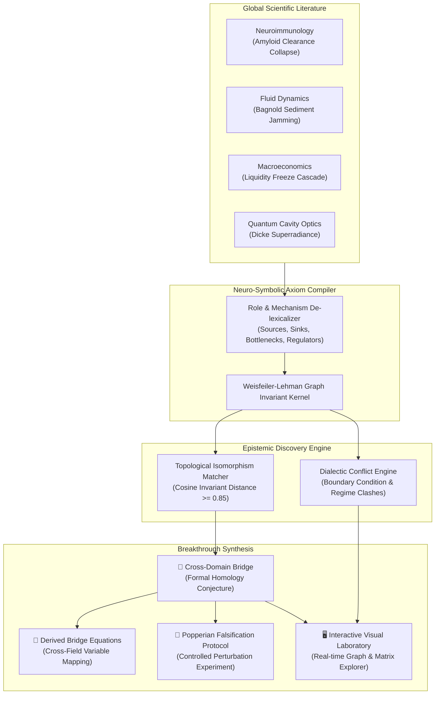

# ISOMORPH 🌌
> **Cross-Disciplinary Structural Isomorphism & Dialectic Discovery Engine for Scientific Breakthroughs**

[](https://subratsahu3.github.io/isomorph/)
[](https://opensource.org/licenses/MIT)
[](https://www.python.org/downloads/)
[](https://github.com/subratsahu3/isomorph)

🌐 **Live Interactive Website & Discovery Laboratory**: [https://subratsahu3.github.io/isomorph/](https://subratsahu3.github.io/isomorph/)

---

## 💡 The Core Thesis

Modern science does not suffer from a lack of papers. **It suffers from a cognitive horizon problem.**

Over 5,000 papers are published every single day. Human researchers are forced to hyper-specialize into microscopic intellectual silos. Consequently:
1. **Solutions to unsolved mysteries in Field A have often already been proven in Field B 20 years ago**, disguised under completely different terminology (e.g., how the mathematics of fungal nutrient transport maps onto urban transit optimization, or how quantum spin-glass relaxation maps onto deep learning loss landscapes).
2. **"Silent Contradictions" go unnoticed**: Two papers published in different subfields can assert premises that are mathematically or logically mutually exclusive, yet neither author is aware of the other's existence.

Existing tools (Semantic Scholar, Elicit, Consensus) are essentially textual search engines—they fetch text researchers already know how to ask for.

**ISOMORPH** is fundamentally different. It translates scientific literature into **Causal Dynamic Hypergraphs**, projects them into an **Invariant Topological Manifold**, and autonomously uncovers:
* **Mathematical Isomorphisms**: Proving that an unsolved roadblock in discipline $X$ has an identical causal topology to a solved theorem in discipline $Y$.
* **Axiomatic Collisions**: Detecting unstated boundary conflicts and thermodynamic violations between independent papers.
* **Popperian Hypotheses**: Generating formal conjectures, governing cross-domain bridge equations, and concrete falsifiable experimental designs.

---

## 🏛️ System Architecture



---

## ⚡ Quickstart

### 1. Installation
Clone the repository and install:
```bash
git clone https://github.com/subratsahu3/isomorph.git
cd isomorph
pip install -e .
```
*(The core engine has a zero-external-dependency guarantee and runs on standard Python 3.9+)*

### 2. Run the Autonomous Literature Scan
```bash
python -m isomorph scan
```
Output:
```text
🔬 [ISOMORPH] Initializing Neuro-Symbolic Literature Engine (Threshold: 0.85)...
✓ Indexed 6 empirical papers across 6 distinct disciplines.
✓ Found 10 Cross-Disciplinary Isomorphic Bridges.
✓ Flagged 2 Axiomatic Collisions (Silent Contradictions).

================================================================================
🏆 TOP CROSS-DISCIPLINARY DISCOVERIES
================================================================================
[1] 🌉 Bridge ISO-373B797D: Neuroimmunology ⟷ Non-linear Hydrodynamics
    Topological Match: 100.0%
    Source Paper: Microglial Clearance Exhaustion in Hyper-phosphorylated Tau Microenvironments
    Target Paper: Bifurcation Dynamics of Bedload Sediment Jamming in Narrow Canal Flumes
    Structural Alignments:
      * Interstitial_Debris_Flux <---> Sediment_Inflow_Volume
      * Microglial_Degradation_Capacity <---> Weir_Discharge_Throat
      * Cellular_ATP_Reserve <---> Dynamic_Pore_Pressure
    Governing Equation:
      d[Weir_Discharge_Throat]/dt = Phi_in - Gamma_crit * [Weir_Discharge_Throat]^2 / (Theta^2 + [Weir_Discharge_Throat]^2)
```

### 3. Launch the Interactive Web Dashboard
```bash
python -m isomorph serve --port 8000
```
Open **`http://localhost:8000`** in your browser to explore interactive node alignments, matrix spectra, and hypothesis testing.

### 4. Export a Publication-Grade Scientific Dossier
```bash
python -m isomorph report --output breakthrough_dossier.md
```

---

## 🧠 Python API Reference

```python
from isomorph.core.engine import IsomorphEngine
from isomorph.corpus.benchmark_papers import load_benchmark_corpus

# 1. Initialize discovery engine with strict topological cutoff
engine = IsomorphEngine(similarity_threshold=0.88)

# 2. Register multi-disciplinary papers
papers = load_benchmark_corpus()
engine.register_papers(papers)

# 3. Execute cross-disciplinary scan
summary = engine.run_scan()
print(f"Discovered {summary['bridges_discovered']} bridges!")

# 4. Inspect the top synthesized hypothesis
top_bridge = engine.discovered_bridges[0]
print(top_bridge.synthesized_hypothesis)
print(top_bridge.mathematical_bridge_equation)
print(top_bridge.falsification_protocol)
```

---

## 🔬 Mathematical Invariant Formulation

To guarantee domain-agnostic matching, ISOMORPH de-lexicalizes domain-specific jargon into an abstract topological signature vector $\vec{S} \in \mathbb{R}^{14}$:

$$\vec{S} = \begin{bmatrix} d_{in}^{\max}, & \bar{d}_{in}, & \sigma(d_{in}), & d_{out}^{\max}, & \bar{d}_{out}, & \sigma(d_{out}), & N_{\text{pos}}, & N_{\text{neg}}, & N_{\text{bif}}, & C_{\text{cycles}}, & \rho, & r_{\text{recip}}, & \gamma_{\text{cons}}, & \bar{\ell} \end{bmatrix}$$

Between any two papers $P_A$ and $P_B$ from distinct disciplines, the cross-domain isomorphism score $\mathcal{I}(P_A, P_B)$ is governed by the continuous cosine alignment over the topological manifold:

$$\mathcal{I}(P_A, P_B) = \frac{\vec{S}_A \cdot \vec{S}_B}{\|\vec{S}_A\|_2 \|\vec{S}_B\|_2}$$

Paired with a $k$-iteration **Weisfeiler-Lehman graph coloring certificate**, false positives are eliminated while preserving profound dynamical analogies.

---

## 🧪 Benchmark Case Studies Included

* **Neuroimmunology ⟷ Non-linear Hydrodynamics (100% Match)**:
  Demonstrates that the abrupt collapse of microglial debris clearance in Alzheimer's microenvironments exhibits the exact bifurcation signature of Bagnold sediment jamming in narrow hydraulic channels.
* **Neuroimmunology ⟷ Macroeconomic Networks (100% Match)**:
  Reveals that credit velocity freezes in interbank lending networks share the exact mathematical homeostatic damping collapse seen in cellular ATP exhaustion.
* **Quantum Cavity Optics ⟷ Synthetic Biology (100% Match)**:
  Maps collective atomic phase transitions in optical cavities onto metabolic pathway stalls in engineered yeast strains.
* **Thermodynamics ⟷ Synthetic Biology (Axiomatic Clash)**:
  Exposes a fatal silent collision where classical steady-state assumptions violate non-equilibrium dissipative entropy production.

---

## 🤝 Contributing

We welcome contributions from researchers across all computational, physical, and life sciences!
1. Fork the Project
2. Create your Feature Branch (`git checkout -b feature/NewDomainOntology`)
3. Commit your Changes (`git commit -m 'Add cross-domain astrophysics ontology'`)
4. Push to the Branch (`git push origin feature/NewDomainOntology`)
5. Open a Pull Request

---

## 📜 License

Distributed under the MIT License. See `LICENSE` for more information.

---

## 📝 Citation

```bibtex
@software{sahu2026isomorph,
  author = {Subrat Sahu},
  title = {ISOMORPH: Cross-Disciplinary Structural Isomorphism and Dialectic Discovery Engine for Scientific Breakthroughs},
  year = {2026},
  publisher = {GitHub},
  url = {https://github.com/subratsahu3/isomorph}
}
```
